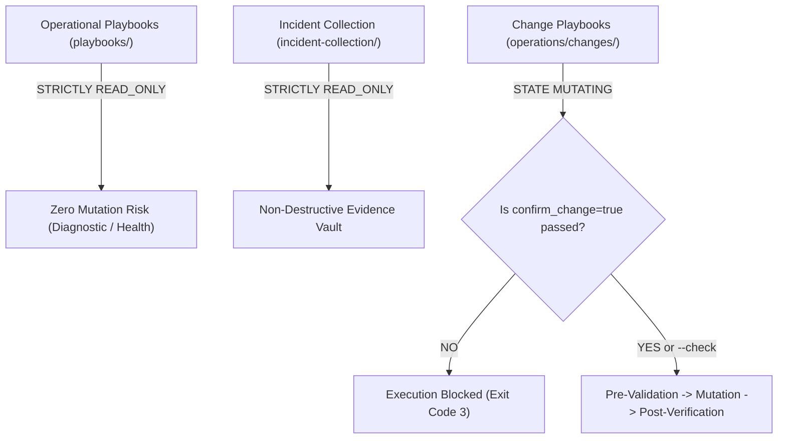

# Enterprise Change Management & Safety Separation Guide

**Target Audience:** L3 Change Implementers, Infrastructure Leads, CAB (Change Advisory Board) Reviewers  
**Framework Version:** 1.0.0-Enterprise  
**Classification:** Change Governance & Operational Safety Standard  

---

## 1. Principles of Enterprise Change Separation
In production multi-customer enterprise environments, an unverified or accidental configuration change can trigger cascading outages. This framework enforces strict physical separation between diagnostic automation and state-mutating automation.



---

## 2. The Three Pillars of Change Safety

### 2.1 The Confirmation Guard
Every change playbook in `operations/changes/` begins with an assertion task:
```yaml
  pre_tasks:
    - name: 1. Change Authorization & Safety Assertion
      ansible.builtin.fail:
        msg: >
          CRITICAL ERROR: Change has NOT been confirmed!
          This playbook modifies configuration on production infrastructure.
          To execute this change, you must explicitly supply: -e "confirm_change=true"
          Alternatively, test this change using --check mode.
      when: not (confirm_change | bool) and not ansible_check_mode
```
If an operator runs `ansible-playbook operations/changes/...` by accident without `-e "confirm_change=true"`, execution is halted immediately on task 1 with zero changes made.

### 2.2 Mandatory Check Mode Support
All change playbooks fully support Ansible check mode (`--check` / `--diff`).
Operators can simulate any change in advance to observe what lines in `/etc/sysctl.conf`, which LVM extents, or which snapshots would be modified, without executing the actual mutation:
```bash
./scripts/run-playbook.sh -p operations/changes/linux/change_linux_kernel_sysctl.yml -c -l node1
```

### 2.3 Pre-Change Baseline & Post-Change Verification
Before applying any change, operators execute:
```bash
# Capture Pre-Change Health Snapshot
ansible-playbook -i inventories/lab/hosts.yml operations/validation/pre_change_validation.yml -e "chg_id=CHG98231"

# Execute Authorized Change
ansible-playbook -i inventories/lab/hosts.yml operations/changes/linux/change_linux_kernel_sysctl.yml -e "chg_id=CHG98231 confirm_change=true"

# Execute Post-Change Verification & Drift Audit
ansible-playbook -i inventories/lab/hosts.yml operations/post-change-verification/post_change_verification.yml -e "chg_id=CHG98231"
```
The post-change verification engine compares live running state against the baseline and asserts that all critical services remain active and no file systems breached capacity thresholds.
