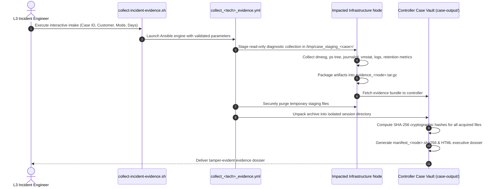

# Enterprise Incident Evidence Collection & Forensic Runbook

**Target Audience:** L3 Incident Responders, Forensic Analysts, Site Reliability Engineers  
**Framework Version:** 1.0.0-Enterprise  
**Classification:** Forensic Standard Operating Procedure  

---

## 1. Forensic Acquisition Architecture & Chain of Custody
The Incident Evidence Collection engine implements automated, tamper-evident data acquisition compliant with ISO/IEC 27037 (Guidelines for identification, collection, acquisition, and preservation of digital evidence).



---

## 2. Collection Modes & Granularity Profiles

### 2.1 Collection Modes
- **MODE 1: Last N Days (Historical Retrospective)**
  - Collects telemetry spanning the previous 3, 5, 7, 10, 15, or 30 days.
  - Used when an issue occurred recently and general performance deterioration must be tracked.
- **MODE 2: Incident-Centric Window (Target Date +/- Window)**
  - Requires specifying the exact incident occurrence date (e.g. `2026-11-20`) plus days before and after.
  - Slices journald logs, system logs, and SAR metrics specifically around the failure event to eliminate noise.

### 2.2 Granularity Profiles
- **Quick:** Immediate triage snapshot (Uptime, load, top 20 processes, active sockets, last 500 journal lines). Execution time: ~3-5 seconds.
- **Standard (Default):** Complete triage (Process tree, memory slab, vmstat/iostat, dmesg, last 2500 log lines, SAR metrics, retention analysis). Execution time: ~10-15 seconds.
- **Comprehensive:** Deep forensic collection (Complete core system logs, journald full dumps, SAR archives, full system configuration, hardware traces). Execution time: ~30-60 seconds.

---

## 3. Interactive CLI Intake Usage
The easiest method to acquire evidence is using the interactive wrapper:
```bash
./scripts/collect-incident-evidence.sh
```
Follow the interactive prompts:
```
==============================================================================
ENTERPRISE INCIDENT EVIDENCE COLLECTION ENGINE
==============================================================================
Enter ServiceNow / Jira Incident Case ID: INC0091823
Enter Customer or Environment Name      : ACME-FINANCE-PROD
Select Technology Domain:
  1) Linux (RHEL / OEL / SLES / Ubuntu)
  2) IBM AIX
  3) Microsoft Windows Server
  4) VMware vSphere
  5) Oracle Linux Virtualization Manager (OLVM)
  6) Enterprise KVM Hypervisor
  7) Enterprise Storage (IBM / HPE / Dell)
  8) SAN Switches (Brocade / Cisco MDS)
  9) High-Availability Clustering (PowerHA / GPFS / VCS)
 10) Enterprise Backup & DR (Spectrum Protect / NetBackup)
Select Technology (1-10): 1
Select Collection Mode:
  1) MODE 1: Last N Days
  2) MODE 2: Incident-Centred Window
Select Mode (1-2): 1
Select Number of Days [3, 5, 7, 10, 15, 30]: 7
Select Granularity Profile: standard
Enter Target Hostname or Ansible Group : linux_all
```

---

## 4. Evidence Vault Layout & Verification
All acquired files are deposited into:
```
case-output/<CASE_ID>/session_<TIMESTAMP>/
├── case-details/
│   └── case_metadata_<node>.txt
├── <domain>/<node>/
│   ├── dmesg.txt
│   ├── journal.log
│   ├── messages.tail
│   ├── ps_tree.txt
│   ├── meminfo.txt
│   └── retention_analysis.txt
├── manifests/
│   └── manifest_<node>.sha256
└── reports/
    └── incident_summary_<node>.html
```

To verify the integrity of the evidence vault at any future date:
```bash
cd case-output/INC0091823/session_20261120_004541/
sha256sum -c manifests/manifest_ansible-nfs.lab.local.sha256
```
Any altered byte in an evidence file will immediately fail the cryptographic checksum check.
