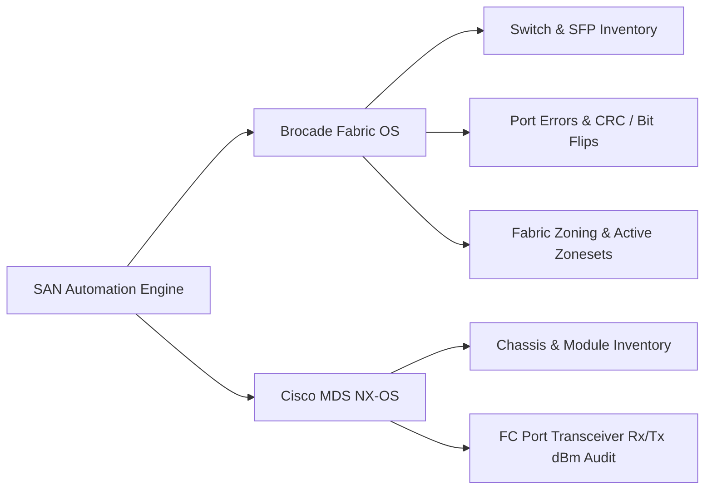

# Enterprise Storage & SAN Switches Automation Guide

**Target Audience:** L3 Storage Administrators, SAN Specialists, Infrastructure Architects  
**Framework Version:** 1.0.0-Enterprise  
**Classification:** Operational Runbook  

---

## 1. Storage Arrays Automation Matrix (6 Playbooks)
Located in `playbooks/storage/`, these playbooks target enterprise storage arrays across IBM, HPE, and Dell.

### IBM FlashSystem & SVC
- `storage_ibm_inventory.yml`: Discovers enclosure serials, canister health, battery backup units, and SAS chains via `lssystem` and `lsnode`.
- `storage_ibm_health_capacity.yml`: Captures storage pool overcommit (`lsmdiskgrp`), compression savings, volume maps (`lsvdiskhostmap`), and alerts on pools > 85% full.

### HPE 3PAR & Primera
- `storage_hpe_inventory.yml`: Audits node pairs, drive cages, physical disks, and controller status via `showsys` and `shownode`.
- `storage_hpe_health_capacity.yml`: Evaluates Common Provisioning Groups (CPG), thin provisioning savings, and virtual volumes (`showvv`).

### Dell PowerStore
- `storage_dell_inventory.yml`: Discovers appliance clustering, power supply redundancy, and NVMe flash tiers.
- `storage_dell_health_capacity.yml`: Audits physical storage metrics, data reduction ratios, and snapshot storage consumption.

---

## 2. SAN Switches Automation Matrix (5 Playbooks)
Located in `playbooks/san-switches/`, these playbooks automate Fibre Channel switch fabrics across Brocade and Cisco MDS.

### Brocade Fabric OS (FOS)
- `san_brocade_switch_inventory.yml`: Runs `switchshow`, `chassisshow`, and `firmwareshow`.
- `san_brocade_port_health.yml`: Identifies SFP optical TX/RX power levels (`sfpshow`), link CRC error increments, and encoding errors.
- `san_brocade_fabric_health.yml`: Audits fabric configuration, active zoneset, and zone alias definitions via `cfgshow`.

### Cisco MDS (NX-OS)
- `san_cisco_mds_inventory.yml`: Audits Cisco MDS 9000 chassis, line cards, supervisor engines via `cisco.nxos` modules (`show version`, `show module`).
- `san_cisco_fabric_port_audit.yml`: Analyzes VSAN memberships, FC interface operational speeds (4/8/16/32/64G), buffer-to-buffer credit drops (`show interface fc`), and transceiver optical diagnostics.

---

## 3. Operational L3 Runbook: Troubleshooting SFP CRC Errors
When a storage host experiences I/O latency or multipath degraded paths:
1. Run `./scripts/run-playbook.sh -p playbooks/san-switches/brocade/san_brocade_port_health.yml`.
2. Inspect `reports/performance/<switch>/brocade_port_health.txt` for ports with `enc_in`, `crc_err`, or `link_fail` counter increments.
3. If optical Rx power is below `-12 dBm`, flag the patch cable or SFP transceiver for physical replacement.
