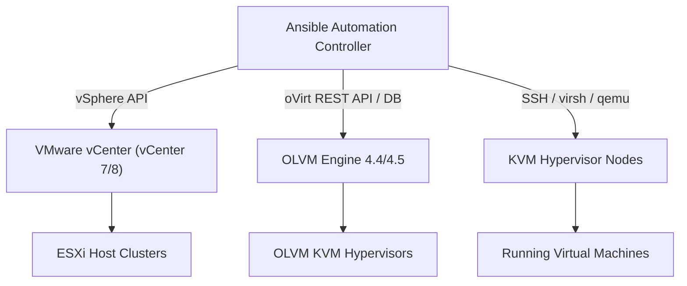

# Enterprise Virtualization Playbook Guide (VMware, OLVM, KVM)

**Target Audience:** L3 Virtualization Engineers, Cloud Infrastructure Administrators  
**Framework Version:** 1.0.0-Enterprise  
**Classification:** Operational Runbook  

---

## 1. Overview & Architecture
The virtualization automation suite covers the three enterprise hypervisor stacks:
- **VMware vSphere (5 Playbooks):** Managed via `community.vmware` modules against vCenter Server REST/SOAP APIs.
- **Oracle Linux Virtualization Manager (17 Playbooks):** Managed via `ovirt.ovirt` modules against OLVM/oVirt 4.4/4.5 REST engine and PostgreSQL database backend.
- **Enterprise KVM (9 Playbooks):** Direct host inspection of `libvirtd`, QEMU, KVM kernel modules, and Open vSwitch / Linux Bridges.

---

## 2. VMware vSphere Automation Matrix

| Playbook | Primary Module (FQCN) | Operational Role |
| :--- | :--- | :--- |
| `vmware_vcenter_inventory.yml` | `community.vmware.vmware_host_facts` | Complete compute cluster, host, and datastore topology |
| `vmware_esxi_host_health.yml` | `community.vmware.vmware_host_facts` | Maintenance state, CPU/RAM reservations, hypervisor build |
| `vmware_datastore_capacity_audit.yml`| `community.vmware.vmware_datastore_info` | VMFS / vSAN datastore utilization, overcommit ratios |
| `vmware_vm_resource_inventory.yml` | `community.vmware.vmware_vm_info` | vCPU, allocated RAM, VMware Tools status, IP addresses |
| `vmware_snapshot_audit.yml` | `community.vmware.vmware_guest_snapshot_info` | Stale snapshots older than 3 days, consolidation alerts |

---

## 3. Oracle Linux Virtualization Manager (OLVM) Matrix (17 Playbooks)

| Playbook | Primary Module (FQCN) | Operational Role |
| :--- | :--- | :--- |
| `olvm_manager_inventory.yml` | `ovirt.ovirt.ovirt_cluster_info` | Datacenter and cluster inventory, compatibility levels |
| `olvm_cluster_host_health.yml`| `ovirt.ovirt.ovirt_host_info` | SPM (Storage Pool Manager) role, CPU flags, status |
| `olvm_vm_inventory.yml` | `ovirt.ovirt.ovirt_vm_info` | Complete VM inventory, CPU pin topology, boot order |
| `olvm_datastore_audit.yml` | `ovirt.ovirt.ovirt_storage_domain_info` | NFS / iSCSI / FC Storage Domains, free space alerts |
| `olvm_network_audit.yml` | `ovirt.ovirt.ovirt_network_info` | Logical networks, VLAN tags, VM network QoS profiles |
| `olvm_snapshot_inventory.yml`| `ovirt.ovirt.ovirt_snapshot_info` | VM snapshot hierarchies, creation timestamps |
| `olvm_vm_resource_audit.yml` | `ovirt.ovirt.ovirt_vm_info` | Underutilized and overprovisioned virtual workloads |
| `olvm_engine_system_health_audit.yml`| `ansible.builtin.shell` | Engine service, PostgreSQL health, JVM resources |
| `olvm_affinity_groups_audit.yml`| `ovirt.ovirt.ovirt_affinity_label_info` | Affinity labels and database scheduling policies |
| `olvm_storage_pool_manager_spm_audit.yml`| `ansible.builtin.shell` | SPM election status, SANlock leases, and failovers |
| `olvm_mac_pool_ip_allocation_audit.yml`| `ovirt.ovirt.ovirt_network_info` | MAC address pool ranges and duplicate MAC detection |
| `olvm_vm_ha_reservation_audit.yml`| `ovirt.ovirt.ovirt_vm_info` | HA VMs, watchdog devices, and cluster HA spare capacity |
| `olvm_storage_domain_luns_audit.yml`| `ovirt.ovirt.ovirt_storage_domain_info` | Underlying FC/iSCSI LUN identifiers and multipath |
| `olvm_vnic_profiles_qos_audit.yml`| `ovirt.ovirt.ovirt_vnic_profile_info` | vNIC profiles, port mirroring, network filters & QoS |
| `olvm_event_log_audit.yml` | `ovirt.ovirt.ovirt_event_info` | Engine events, warnings, host fencing, and crash logs |
| `olvm_vm_migration_policy_audit.yml`| `ansible.builtin.shell` | Cluster migration bandwidth limits and auto-converge |
| `olvm_template_disk_leak_audit.yml`| `ovirt.ovirt.ovirt_template_info` | VM templates, gold images, and floating disk leaks |

---

## 4. Enterprise KVM Hypervisor Matrix (9 Playbooks)

| Playbook | Key Commands & Modules | Operational Role |
| :--- | :--- | :--- |
| `kvm_host_resource_audit.yml` | `virsh list --all`, `virsh nodeinfo`, `brctl / ip link` | Libvirtd status, host CPU overcommit, vSwitch bridges |
| `kvm_qemu_guest_agent_audit.yml` | `virsh qemu-agent-command` | Guest agent channel availability & OS ping |
| `kvm_cpu_pinning_numa_audit.yml` | `virsh vcpupin`, `numactl -H`, `numastat` | vCPU pinning mappings, NUMA hit/miss ratios |
| `kvm_virtio_scsi_disk_performance_audit.yml`| `virsh domblklist`, `virsh domblkstat` | virtio-scsi vs virtio-blk, cache policies, I/O stats |
| `kvm_bridge_sriov_network_audit.yml`| `bridge link show`, `ip -s link` | Linux bridges, virtual TAP drops, SR-IOV VFs |
| `kvm_qcow2_disk_integrity_audit.yml`| `qemu-img info`, `virsh pool-list` | qcow2 backing chains, disk allocations, leaks |
| `kvm_live_migration_network_audit.yml`| `ss -tulnp`, `/etc/libvirt/libvirtd.conf` | Migration ports (49152-49215), MTU sizes, PKI TLS |
| `kvm_guest_panic_crash_audit.yml` | `virsh dumpxml`, `pvpanic`, `watchdog` | on_crash lifecycle policies, hypervisor core dumps |
| `kvm_hugepages_memory_backing_audit.yml`| `hugetlbfs`, `/proc/meminfo`, `memoryBacking` | 2MB/1GB hugepage memory pools, guest allocation |

### Live Lab Validation Results:
`kvm_host_resource_audit.yml` was executed against live lab nodes `kvm-host-1.lab.local` and `kvm-host-2.lab.local`:
- Confirmed active `ovirtmgmt` bridge interfaces.
- Validated `libvirtd` systemd services running.
- Captured CPU physical cores vs. virtual assigned threads.
